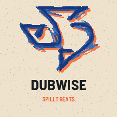
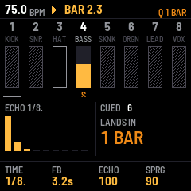

# Dubwise FM

<p>
  
  
</p>

**A reggae and dub mixing desk you play live, as firmware for the M-VAVE FM-1.**

In dub, the mixing desk is the instrument. King Tubby, Lee "Scratch" Perry, Scientist and the engineers after them took
a finished riddim and remade it live at the board: dropping instruments out on the one, throwing a snare or a word into
a tape echo until it rang, striking the spring reverb like a drum, and stepping a high-pass filter until the band
evaporated. Dubwise FM puts that desk under your fingers. It has eight channels of FM drums, bass, skank, organ,
melodica and sirens. Each has a mute and a throw, feeding a tape echo and a spring you can kick. A countdown
"runway" lands every move on the one.

Nothing plays by itself. Every drop, throw and sweep is yours. You can record those moves into a song, recall them as
scenes, or save them as versions.

**Play it in your browser:** https://docruzzy.github.io/dubwise-fm/emu/ (the same firmware code, compiled to
WebAssembly; live once GitHub Pages is switched on).

A **SpIllt Beats** release, by DocRuzzy.

## Built on the dub greats

Every tool in Dubwise is modelled on a technique the dub engineers used, as documented in interviews, studio histories
and the gear itself. The research, with its sources and where they disagree, is in
[`docs/mastery-guide.md`](docs/mastery-guide.md). Dubwise is inspired by this work. It isn't affiliated with or endorsed
by any of the artists, studios or labels named here.

### The desk as the instrument

| In Dubwise | Inspired by |
|---|---|
| **Quantised mutes, solos and the runway.** Mute keys that land on the next beat, bar or phrase, a fraction early. A countdown shows when the next 8/16/32-bar line arrives. | Tubby mixed live: tracks were "dropped out and brought back as the tape played", and the engineer was compared to a jazz soloist. The "fraction before the beat" timing is from *Sound On Sound*'s dub workshop. |
| **Drum and bass** (black 11, held): everything but the rhythm section drops out. | The earliest name for a dub was "bass and drum". Think of Tubby's drum-and-bass sections against Augustus Pablo's melodica on *King Tubbys Meets Rockers Uptown*. |
| **Drop to wet** (black 5, held): the dry desk drops out, and only the echo and spring keep sounding. | The classic dub breakdown: the band goes, the effects carry the song. |
| **Throws.** Hold a key to send a channel into the echo or spring at full level, before the fader and even when muted. Hit harder for a bigger throw. | The echo throw: a single word, snare or horn stab sent into the delay and left to ring. |
| **Scenes and versions.** 16 recallable desks, each optionally with its own patterns. | Versioning: one riddim becomes a vocal cut, a DJ cut and a dub (Bunny Lee, Coxsone Dodd's rhythm library, Joe Gibbs). |
| **Songs that keep your moves.** Up to 512 bars of mutes, scenes and section markers, plus every throw and knob turn inside each bar. Punch in one control without touching the rest. | The one-take mixing pass, where the dub is the performance. |

### The effects

| In Dubwise | Inspired by |
|---|---|
| **The Big Knob.** A steep, stepped high-pass filter: OFF, then 70, 100, 150, 250, 500 Hz, 1, 2, 3, 5 and 7.5 kHz. It jumps between steps with no smoothing, because the click of each step is the sound. Optional finer 20- and 40-step settings. | King Tubby's "Big Knob": a passive Altec 9069B high-pass filter on the MCI desk he bought from Dynamic Sounds in 1972. Scientist says much of the "phasing" heard on Tubby's records was really this filter. |
| **The tape echo.** Each repeat is darker than the last (filters inside the feedback loop) and saturated like tape. **Push** drives it past self-oscillation, **freeze** holds the loop, and **tape dive** slows the tape so the repeats bend down in pitch. | The Roland RE-201 Space Echo at Perry's Black Ark, and tape-loop echoes: repeats fed back through tape saturation; turning Repeat Rate while it rings makes the pitch glide. |
| **The spring and its crash.** A two-spring reverb you can strike for a thunderclap, even with nothing sent to it. | Tubby physically hit his spring unit. Nick Manasseh confirms striking the spring with a stick. The Black Ark spring was a Grampian. |
| **Cross-sends and feedback.** The echo's return fed into the spring and back. Capped, so it can't run away. | Returns brought back on full channel strips that can send to themselves, the feedback routing *Sound On Sound* and Mad Professor describe as the basic technique. |
| **The dual Bi-Phase.** Two six-stage phasers, alone, cascaded into twelve stages, or swept against each other in stereo. | The Mu-Tron Bi-Phase at the Black Ark, a Perry, Black Ark and On-U signature, on hi-hats, chops and whole mixes. |
| **Ping-pong echo and echo width.** Stereo only on the returns. The bass and kick stay centred and mono. | Mad Professor: "I took dub into the world of stereo". Many 1970s dubs were mono for sound systems and 7-inch singles, and later dub kept stereo mostly in the effect returns. |
| **Tape drive.** The bass or the whole mix pushed into tape saturation. | Daniel Boyle's tape-saturated passes ("slam it really hard") on the bass. |
| **Snare-keyed spring gate.** Every snare opens the spring briefly, so a long reverb is chopped into a rhythmic tail. | Gates on reverb returns, as at Mad Professor's Ariwa studio (DS201 gates) and in *Sound On Sound*'s "skatter" gate. |

### The band and the sound system

| In Dubwise | Inspired by |
|---|---|
| **Riddims:** ONE DROP, ROCKERS, STEPPERS, FLYERS and UK STEPPERS, to start from and then edit step by step. | One drop's kick and rim on beat 3 alone. Rockers from Channel One around 1976, with Sly Dunbar's double rimshot. Steppers' kick on every beat, Channel One onwards and the UK sound-system standard after Jah Shaka. The flying cymbal: Santa Davis, 1974, named by Bunny Lee. |
| **FM voices:** a staccato bass that leaves beat 1 empty, a tight rim, a choked hi-hat, the skank chop on 2 and 4, the organ bubble, and melodica and brass. | The Kingston session conventions, like the skank as "the piston of a steam engine", and Augustus Pablo's melodica. |
| **Sirens and one-shots** (BIM, HORN, LASER), thrown into the echo like a word. Hold HOME to play a one-shot backwards. | Jah Shaka's siren. Tubby's test tones on deep echo. Vocal snippets thrown into the delay. Adrian Sherwood turning the reel over to mix backwards. |
| **Rewind** (HOME + PLAY): the record dragged back, a beat's silence, then from the top. | Sound-system rewind culture: "pull up, selecta, come again". |
| **Mono, clean low end.** Nothing below about 150 Hz ever differs between left and right. | Tubby's sound system amplified bass and treble separately. Sound systems want the bass solid and centred. |
| **Guard tiers: Studio, Four-track, Seven-inch.** When the processor is busy, Dubwise steps down rather than drop out. | The cheap and cast-off four-track systems the greats worked on, and the seven-inch single. |

There's also a demo, **RIGHTEOUS DUB**: an original 41-bar riddim and dub in the 1970s Kingston manner, with the
engineer's moves built in, that tours every voice, model and effect (SETUP → DEMO SONG). The manual ends with a few hidden things for those who read to the end.

## Status

**Beta, not yet tested on a real FM-1.** The roadmap is built (P0 desk and sequencer, P1 signature tone, P2 colour,
leads and live input, P3 wishlist) and checked by 37 host-simulator scenarios with audio analysis. The device package
builds and passes fm1-base's install simulation. The live USB-audio input waits on a proposed fm1-base change
([`docs/upstream/`](docs/upstream/)). See [`docs/roadmap.md`](docs/roadmap.md), the manual in
[`app/docs/MANUAL.md`](app/docs/MANUAL.md), and the release checklist in
[`docs/release-checklist.md`](docs/release-checklist.md).

## Layout
| Path | What |
|---|---|
| `app/` | The firmware (started from fm1-base's template) |
| `base/` | [fm1-base](https://github.com/charlesvestal/fm1-base) as a pinned submodule (MPL-2.0), with [felucca-bsp](https://github.com/hugelton/felucca-bsp) inside |
| `docs/` | Design principles, roadmap, interface spec, prior-art notes, the dub mastery guide, reviews |
| `tools/` | Generators (the one-shots) |
| `CLAUDE.md` | Rules and context for AI-assisted development |

## Build
```
git clone --recursive https://github.com/DocRuzzy/dubwise-fm
tests/run_tests.sh        # host simulator + scenario tests (any Linux/macOS with a C compiler and Python 3 + Pillow)
./build.sh --web          # browser emulator (emscripten 6.0.10): serve app/build/emu/ over HTTP
./build.sh                # device package app/build/dubwise.fwsc (JieLi Linux x86-64 toolchain + AC79 SDK files; see base/README.md)
python3 base/tools/fm1_install.py app/build/dubwise.fwsc
```
On Windows, use WSL2: the JieLi toolchain is Linux x86-64 only. Releases are built and signed on GitHub from a
`vX.Y` tag (`.github/workflows/release.yml`). The browser version publishes from `main` (`pages.yml`).

Installing custom firmware is at your own risk. The web installer and M-VAVE's updater can restore the stock firmware.

## Licence
GPL-3.0-only (see `LICENSE`). Files derived from fm1-base's template keep their MPL-2.0 headers, and fm1-base and
felucca-bsp are MPL-2.0. See `CREDITS.md`.

M-VAVE and FM-1 are trademarks of their owners. Dubwise FM is not affiliated with M-VAVE, Hügelton Instruments or the
fm1-base project. Artists, studios and labels are named to credit their techniques, not to claim any connection.
