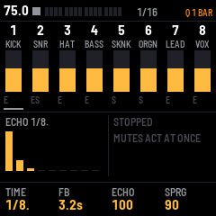
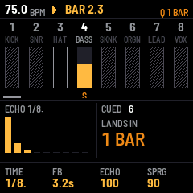
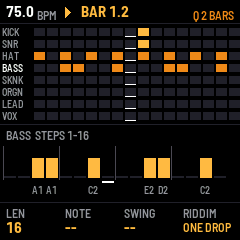
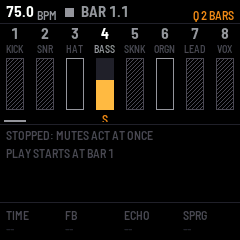

# DUBWISE

DUBWISE (Dubwise FM, a SpIllt Beats release by DocRuzzy) turns the M-VAVE FM-1 into a reggae and dub mixing desk
you play live. Eight channels (FM kick, snare, hats, bass, skank, organ bubble, melodica or brass, and sirens and
shouts) play a riddim; your hands do the dub: mutes and solos that land on the one, throws into a tape echo and a
spring you can kick, the stepped Big Knob filter, freezes, pushes, tape dives, drop to wet, drum and bass, rewinds.
Record every move into a song, recall scenes, keep four projects in slots.

Press PLAY and you're dubbing: the ONE DROP riddim starts. SEQ edits the patterns (or loads another riddim), FX the
effects, ARP the key and the chord lane, GLO the SETUP page, HOME the scenes and the song. For a ready-made dub to
play along with, load the demo, RIGHTEOUS DUB (SETUP → DEMO SONG). The one-page cheat sheet:
https://docruzzy.github.io/dubwise-fm/cheat/



---

## Contents

1. Install
2. The screen
3. Controls
4. Saving
5. MIDI and audio
6. The screen reader
7. Troubleshooting

---

## 1. Install

To try it first, open the emulator. It runs the same code in your browser, with sound, and you can play it with a
mouse, a touch screen or your computer keyboard.

To install it from the browser, use Chrome or Edge. Connect the FM-1 by USB, open the installer and press Install.
The browser asks once to allow MIDI, so allow it. Don't unplug the cable while it writes.

To install it from a terminal, run `python3 tools/fm1_install.py dubwise-VERSION.fwsc`.

To go back to the stock firmware, use the installer's last section, which writes M-VAVE's own firmware back. You
can recover an FM-1 that doesn't start, too. For details, see felucca-bsp's `tools/fm1_rescue.sh`.

---

## 2. The screen



| Part | What it shows |
| --- | --- |
| Header | The tempo, playing (triangle) or stopped (square), the cycle bar (a segment a bar, in fours, this bar filling beat by beat), the bar you're in out of the cycle (5/16), and the quantise setting (Q), with the battery beside it (three bars; red when it's nearly empty, and the FM-1 says BATTERY LOW once; none while USB powers it). It turns amber on the runway. After a change, a message shows here for a moment. While playing, the PLAY button flashes on every beat, in both colours on a bar's first: a metronome for your eyes. |
| Channel strips | The eight channels: 1 KICK, 2 SNR (snare), 3 HAT, 4 BASS, 5 SKNK (skank), 6 ORGN (organ), 7 LEAD, 8 VOX. A filled box is playing, with its level brighter over it. An outlined box is muted. A hatched box is muted by someone else's solo. S marks a solo. A strip that blinks white has a change waiting. A line under a strip marks the focus. Under each box, where a throw sends the channel: E (echo), S (spring) or ES (both). A thrown channel's number lights up. |
| Centre, left | The echo: its time, and its repeats as they fall. They turn amber near endless feedback and red past it. A red line underneath shows the echo's limiter at work. |
| Centre, right | The Big Knob: its steps as an arc (10, 20 or 40: SETUP), and where it is. While something waits, what's waiting (CUED) and when it lands: NEXT BEAT, 1 BAR, 2 BARS and so on. On the runway, the countdown. |
| Bottom line | The four knobs and their values: echo TIME, feedback (FB, how long the repeats take to die away), the ECHO return and the spring return (SPRG). While you hold a mute key, the held channel's LEVEL, ECHO send, spring send (SPRG) and filter. |

---

## 3. Controls

| Control | What it does |
| --- | --- |
| White keys 1–8 | Mute or unmute channels 1–8. A tap toggles. Hold a key to flip the channel only while you hold it. Tap twice quickly to solo it. Solos add up: solo two channels and you hear both. A muted channel stays muted when you solo it. |
| HOME + white key 1–8 | Solo, without the double tap. |
| OCT− · OCT+ | The quantise setting: BEAT, 1, 2, 4, 8, 16 or 32 bars, or CYCLE (the next "one"). While playing, a mute or solo waits for the next line of that setting and lands on it, a hair (10 ms) early so it catches the downbeat. Its key blinks until then. |
| PLAY | Start and stop (when you let go). Starting counts from bar 1. Stopping makes anything waiting happen at once; the echo and spring ring on. **Tap PLAY again within 0.4 s of a stop for TAILS OFF:** the echo and spring fade out in 20 ms and are emptied, without starting (a tap after that starts as usual). Hold PLAY while you press a white key to make that change now instead of on the line. |
| SELECT · BIG KNOB | The Big Knob: a steep high-pass filter in steps, like King Tubby's: OFF, 70, 100, 150, 250, 500 Hz, 1, 2, 3, 5, 7.5 kHz. Each click jumps straight to the next step, which is part of its sound. Sweep it up to make the mix "evaporate", snap it back on the one. On the whole mix, or only the echo's return (SETUP). For finer steps between those, SETUP's BIG KNOB STEPS: 20 or 40. |
| HOME + SELECT | Tempo, 1 BPM a click. |
| HOME + SEQ, tapped | Tap tempo: from the second tap, the average of the last four gaps (a pause over 2 s starts again). Refused while MIDI clock in has the tempo. |
| Any button, held a second on its own | Its help card for this page. It stays when you let go, and the next press (which does nothing else) or 12 s puts the page back. A combo you hold while thinking still works: a knob or key pressed with the button held closes the card and does its job. |
| ALGORITHM | Moves the focus between the channels. |
| EDIT | The SOUND view of the focused channel. While it's open, the middle of the screen draws the voice's shape from its settings: its loudness (white, filled) and a second curve in amber (the kick's pitch falling, the rim's ring, the open hat, the bass's pluck, the lead's vibrato, the siren's sweep), redrawn as you turn a knob, with a line running across it on each hit (not with REDUCED MOTION). First MAIN: four macros, each turning several settings at once along a shaped curve (the kick's PUNCH: the sweep up, the fall quicker, the click up); in the middle (0) everything is at its default. Press EDIT again for the raw settings, four at a time, then once more to go back to the echo's knobs. A raw setting turned after its macro leaves the macro where it is, and MAIN shows a small dot by it. ALGORITHM picks the channel. Channel 8 (VOX) has no MAIN: its first bank is the siren's. **Patches:** on the SOUND view, PRESET steps through the channel's patches and loads each as you turn (INIT and the factory ones first, then your own; a run of turns is one undo step); the footer shows the patch's name, with a * once you've changed it. Hold SAVE and turn PRESET to keep the sound: into the next free slot of the channel's 16 (named BASS 01, BASS 02 ...), or, if one of your patches is showing, over it (it asks twice). Stopped only (writing the flash would interrupt the sound). Your patches belong to the FM-1, not to a project: they're there in every project. **Dice** (the last bank, after the raw ones): press ENV to roll the channel a new sound inside safe bounds (KNOB 2: ROLL), or nudge the current one (MUTATE, by KNOB 1's AMOUNT, 5–100 %). KNOB 4 steps back through the channel's last 8 results, each played in as you reach it. KNOB 3 MORPHs from your sound (as it was when you started turning) towards the result KNOB 4 shows: at 50 % halfway between the two, at 100 % the result, back at 0 % your sound exactly. A good way to find the in-between: roll something wild, load your patch again (PRESET), then turn MORPH. To keep a setting out of it, hold ENV and turn that knob on MAIN or a raw bank: a lock shows. HOME + EDIT rolls from any page. Dice only ever changes the focused voice: never levels, sends, the dub bus, patterns or other channels. Each roll is one undo step; SETUP's DICE ON LINE makes it land on the next quantise line while playing. |
| GLO | The SETUP page (below). |
| MASTER | Sets the volume. |
| SAVE | Saves your project: the tempo, sounds, patterns, scenes, the song and its moves, the FX and SETUP. SAVE lights while there's something to save. On SETUP's slot rows it saves to (or loads from) a song slot instead. |
| KNOB 1 · TIME | The echo's time, in steps of the beat: 1/16, 1/8T, 1/16., 1/8, 1/4T, 1/8. (dotted eighth, the default), 1/4, 1/2T, 1/4., 1/2. At slow tempos the longest don't fit, so you get the longest that does. A change glides like tape, bending the pitch. |
| KNOB 2 · FB | How long the repeats last: the time they take to fall 60 dB, from 0.1 s to endless (INF). |
| KNOB 3 · ECHO | The echo's return level. |
| KNOB 4 · SPRG | The spring's return level. |
| Hold white key 1–8 + KNOB 1–3 | That channel's level, echo send and spring send. Turning a knob while you hold the key keeps the key from flipping the mute. |
| Black key 2 | Echo hold, while held: no new sound goes in, and the tape loops as it is. |
| Black key 3 | Dub push, while held: feedback past endless, so the echo builds and rings. The tape's saturation and the limiter keep it from blowing up. |
| White keys 9–16 | Throw channels 1–8: while you hold the key, the channel goes to its destination, whatever its fader and even when it's muted, and the echo's feedback lifts so the throw rings on. Hit the key harder for a bigger throw: the softest sends about −8 dB, the hardest full level (SETUP: THROW VELOCITY; off, every throw is full). Tap twice quickly to latch a throw on; tap again to let it go. |
| Hold white key 9–16 + KNOB 1 | That channel's throw destination: ECHO, SPRING or BOTH. Choosing doesn't throw. By default the kick, hats, bass, lead and vox go to the echo, the snare to both, the skank and organ to the spring. |
| Black keys 6 · 7 | Siren A (two tones) and siren B (a rising sweep), on channel 8, while held, louder the harder you press. They go into the echo by default. Their pitch, rate, depth and wave: the SOUND view of channel 8 (ALGORITHM to VOX, then EDIT). |
| Black keys 8 · 9 · 10 | One-shots: BIM, HORN, LASER, on channel 8. A tap plays the whole shot; the harder you press, the louder. Like the sirens they go into the echo, so a shot comes back as a dub repeat. Hold HOME and tap one to play it backwards: it swells up instead of dying away. |
| Black key 4 | Tape dive, while held: the echo's tape slows, so its repeats bend down in pitch; let go and they come back up. How far and how fast: FX page, TAPE bank (DIVE ×1.00–2.00, DIVE TIME 0.1–3 s). |
| Black key 5 | Drop to wet, while held: every channel's dry sound drops out, and only the echo and the spring play on. Let go and the band is back. |
| Black key 11 | Drum and bass, while held: the skank, organ, lead and vox drop out (their sends too), leaving the kick, snare, hats and bass. |
| HOME + PLAY | Rewind (the selector calls it: REWIND, COME AGAIN / PULL UP, SELECTA / WHEEL UP): the last second and a half spins backwards like a record pulled back, the echo and spring stop, and after a beat's silence the tune comes again from bar 1. Stopped, it just spins back. |
| HOME + REC · HOME + GLO | Undo · redo, a step at a time: a mute, a key, a knob's turning, a step, a riddim, a scene. Throws, freezes, pushes and the like let go by themselves, so they aren't kept. When your last action was a song capture, HOME + REC takes that pass back first. |
| (Stereo) | The dry sound is mono. Only the echo and the spring are stereo: the spring always, the echo with WIDTH. Below about 150 Hz both sides stay the same, so the bass stays solid and mono. |
| Black key 1 | Spring crash: strikes the spring tank, a thunderclap even with nothing sent to it. Held while you hold a throw key, it sends that throw to the spring as well. |
| FX | The FX page: ECHO (time, feedback, tone, 2T head), SPRING (decay, tone, return), CROSS (the echo's return into the spring, the spring's into the echo), TAPE (the dive), PHASER (where it is: OFF, HATS, SKANK, ECHO or the whole MIX; RATE 0.1–18 Hz, DEPTH, FEEDBACK), GATE (the spring gate: each snare opens the spring for HOLD, then it shuts over RELEASE, so a long spring is chopped into a tail after every snare), DRIVE (tape saturation on the BASS or the whole MIX: DRIVE up to +14 dB into the tape, BLEND with the clean sound; quiet sounds keep their level, loud ones flatten and thicken) and WIDTH (the echo's right side 8–16 ms behind its left, for a wider echo; the phaser's sine or square sweep; PING-PONG, the echo's repeats left, right, left, while the bass in them stays in the middle) and BI-PHASE (a second phaser: MODE SINGLE, CASCADE, the two in a row for deeper sweeps with the second at its own RATE 2, or STEREO, the left and right sweeping against each other, on the echo's return; elsewhere STEREO works as CASCADE so the dry sound stays mono); press FX again for the next. KNOB 1–4 change them. The cross-sends make a loop between the two effects, so they're held back automatically when the echo or the spring is set long: it never runs away. |

The keys light by one rule: bright is playing, dim is muted or not in use yet, and a slow blink means waiting.

---

## 3a. The runway

The music runs in cycles of 16 bars (8, 32 or 64 on the SETUP page), counted from PLAY. Over the last 4 bars of each
cycle (the runway), the header turns amber and a big number counts the bars to the one: 4, 3, 2, 1. In the last bar,
the screen's border pulses on every beat (the white keys too, if you turn that on). On the one, ONE flashes green.
A screen reader hears "4 bars", "3 bars", "2 bars", "last bar", "one". With quantise on CYCLE, a mute or solo lands on
the one, so you can line up a drop without counting.

## 3b. The SETUP page (GLO)

Turn KNOB 1 (or SELECT) to move through the list and KNOB 2 (or PRESET) to change an item. HOME goes back.

| Item | What it does |
| --- | --- |
| CYCLE | The cycle's length: 8, 16, 32 or 64 bars. |
| RUNWAY | How many bars count down: 1, 2, 4 or 8. |
| RUNWAY ON KEYS | The white keys flash the last bar's beats. |
| COUNTDOWN NUMERALS | The big countdown number on the screen. |
| CUE TICK | A short tick on the runway's beats, higher on each bar's first. |
| REDUCED MOTION | No pulsing border, no green flash. The count still shows, and the screen reader still hears it. |
| SCREEN SAVER | OFF, 1, 5 (the default) or 15 minutes: while stopped and untouched that long, a selector at his desk; every 20 seconds his smoke billows out into a big comic-book cloud in the shape of the SpIllt Beats mark, holds, and breaks up, leaving the picture clear for the other half. Any key, button or knob wakes it, and that touch does nothing else, so waking it never mutes or starts anything. It never comes on while playing. |
| CUE LEAD | How early a quantised change lands before its line: 0–50 ms (10 by default, so it catches the downbeat). |
| LOCK MIDI IN | The key lock filters MIDI notes coming in, too (off by default). |
| BIG KNOB ON | Where the Big Knob sits: the whole MIX, or only the ECHO RETURN. |
| BIG KNOB STEPS | 10 ALTEC (the default): the ten steps of King Tubby's filter, the stepped sound. 20 or 40: finer steps, the ten still among them (evenly between them in pitch, and down to 42 Hz under 70), for a smoother climb. A song or scene sounds the same whichever you choose. |
| THROW VELOCITY | ON (the default): a throw is as big as the key was hit. OFF: every throw at full level. |
| MIDI CLOCK | OFF (the default); IN: follow a computer or drum machine over USB: its Start starts Dubwise from bar 1, its Stop stops it, and its clock sets the tempo and keeps the bars in step; OUT: lead: Dubwise sends Start, 24 clocks a beat and Stop, so other gear follows it. |
| REC QUANTISE | Live recording: FEEL (the default; as you played it), HALF (halfway to the grid) or GRID. |
| REC MODE | Recording into a pattern with steps: OVERDUB (adds) or REPLACE (clears what the playhead passes, keeping what you play). |
| REC OFFSET | 0–60 ms (12 by default) taken off each played note's time, for the sound's way to your ears. |
| CLICK | COUNT-IN (the default: a click on every beat while a pass waits for its line), RECORDING (and while recording), or OFF. |
| USB STEMS | What a computer recording the FM-1 over USB gets on channels 3–10, beside the mix on 1–2: CHANNELS (the default: each of the eight channels on its own, dry, after its fader and mute), BUSES (drums, bass, chords, lead and vox, then the echo's return left and right and the spring's left and right), or OFF. |
| MIDI LEARN | Turn KNOB 2 up, then move a DUBWISE control (any knob, the Big Knob, a mute or throw key, a black key's move), then your controller's knob, fader or pad: it now moves that control, over its whole range (a switch: on from the middle up). Up to 32; SAVE keeps them. Turn KNOB 2 down twice to forget them all. A controller's moves are recorded into the song like your hands', but undo doesn't keep them. |
| USB PORT | COMPUTER (the default) or KEYBOARD: a USB-MIDI keyboard or controller plugged into the FM-1 itself, through a powered hub or adapter (the FM-1 gives the port no power). It plays as MIDI does (below), and its knobs work as learned. While it's a keyboard, there's no computer: no USB audio, mirror or backup. |
| AUTOSAVE | ON (the default): what SAVE keeps is saved by itself once you've stopped and left the FM-1 alone for a few seconds (and the echo has died away), so switching off never loses a session; SAVE's light going out says it's done. OFF: only SAVE saves. |
| DICE ON LINE | OFF (the default): a Dice roll lands at once. ON: while playing, it waits for the next quantise line, like a cued mute. |
| HELP | Every help card, to read anywhere: turn KNOB 2 and each card comes up in turn (the same cards as holding a button for a second). Any press puts the page back. |
| TEST TONES | A test tone on every channel (not saved). |
| GUARD TIER | AUTO, or a tier locked as a sound: STUDIO (everything), FOUR-TRACK (mono returns, a simpler spring), SEVEN-INCH (thinner skank and organ, no sub, a plainer echo with heavier tape saturation: rougher, like a 1970s 7-inch). On AUTO, the FM-1 steps down a tier by itself when it's working too hard, and back up when it can; the header shows 4T or 7IN while it's down. |
| PERFORMANCE | Turn KNOB 2: the PERF page, what each part costs and the tier. |
| NEW PROJECT | Turn KNOB 2 twice: a clean start. The desk, sounds, key and chords back to how they were at the first switch-on, ONE DROP in pattern A of each channel, the other patterns, the scenes, the song and its motion empty. Your SETUP preferences and the song slots stay. Until you SAVE (or autosave does), switching off brings your last save back. |
| SAVE TO SLOT | Keep the whole project in one of four slots: the desk, the sounds, the key and chords, the patterns, the scenes, the song and its recorded moves. KNOB 2 picks the slot (it says whether it's empty), then press SAVE. Stopped only. Your SETUP preferences aren't part of it. |
| LOAD SLOT | Bring a slot's project back (KNOB 2 picks it, SAVE loads it), in place of the current one. Press SAVE again afterwards to make it the one that's there at power-on. Stopped only. |
| DEMO SONG | Turn KNOB 2 to load RIGHTEOUS DUB, the demo: an original riddim and its dub in the 1970s Kingston manner, 72 BPM in A minor, 32 bars (INTRO of drum and bass, VERSE with the melodica, VERSION, a DUB section where the hats drop and the Big Knob climbs, a DROP without the bass, the VERSE again, OUTRO, and an END where everything drops to the echo). The engineer's moves are in it, as the song's motion: throws, spring crashes, a freeze, an echo swell, a dub push, a tape dive. It replaces the patterns, scenes, song and motion (until you SAVE, nothing is lost: switch off to get yours back). Press PLAY: the song plays once. Play on top of it: sirens, one-shots, more throws. |
| LOAD KIT | Seven starting points, each a sound for every voice and a suggested dub bus, after the rooms the music came from: TUBBY'S, CHANNEL ONE, BLACK ARK, STUDIO ONE, SHAKA STEPPERS, SLENG TENG (the digital turn) and ROCKERS UPTOWN (the melodica forward). KNOB 2 picks one, KNOB 3 VOICES or VOICES + BUS (the echo, spring, phaser and drive as well), then press SAVE to load it (it asks twice if you have unsaved changes; HOME + REC undoes it). Each voice is set whole, so a kit sounds the same whatever was there before. They're homages, not the rooms' own sounds: tune them by ear. A kit's voices are also patches: on the SOUND view, PRESET finds them by the kit's name (TUBBYS, CH.ONE, BLACKARK ...). |
| UK STEPPERS | Turn KNOB 2 to set the desk up for UK steppers: 140 BPM, A minor, the UK STEPPERS riddim, the sub bass through the tape, the rim into the echo, the skank into the spring, siren A ready. It changes the patterns, sounds and effects, not your song or scenes. Press PLAY, then throw the rim, hold the siren, take the kick out for a bar. 140 BPM is a starting point: set the tempo by ear. |

## 3c. The STEPS page (SEQ)



Press SEQ for the steps, HOME to go back to the DUB page. From the DUB page, hold a channel's mute key and press SEQ to land straight on that channel (its mute stays as it was). The top shows every channel's 16 steps, the middle the
channel you're editing, bigger, with its notes.

| Control | What it does |
| --- | --- |
| White keys 1–16 | Turn a step on or off. |
| Black keys 1–8 | Pick the channel to edit. |
| Hold black key 9 or 10 + a white key | Make that step an accent or a ghost note (again: back to normal). |
| OCT− · OCT+ | The page of 16 steps: 1–16, 17–32, 33–48, 49–64. |
| KNOB 1 · LEN | The pattern's length, 1 to 64 steps. Hold HOME: its GRID instead, 1/8, 1/8T, 1/16, 1/16T (triplets) or 1/32. |
| KNOB 2 · NOTE | The note of the step you hold, or the last one you touched: a semitone a click. On the hats, closed or open. |
| KNOB 3 · SWING | The pattern's swing, 50 % (straight) to 75 %: every other step later. Hold a step: NUDGE it off its line instead, a tick (about 3 ms) a click, up to half a step either way. A step off its line shows a small mark. |
| KNOB 4 · RIDDIM | Load a riddim into the drums and bass: ONE DROP, ROCKERS, STEPPERS, FLYERS or UK STEPPERS. It lands on the next bar line, and then it's just steps you can change. Hold a step: its GATE instead, how long the bass or lead note holds (AUTO: a step for the bass, two for the lead). |
| REC | The keyboard and live recording: see below. |

### Four patterns a channel (the session)

Every channel has four patterns, **A, B, C and D**, each with its own length, grid and swing. One plays; the others
wait. It works like a session in Ableton Live, or an OP-Z: put a bass line in A, its version in B, a busier one in C,
and launch them as the tune goes, while the drums keep their own. The letter by each channel shows which plays, amber
while a launch waits for its line.

| Control | What it does |
| --- | --- |
| HOME + white 1–4 | Launch this channel's A–D. Playing, it lands on the next line of the quantise setting (hold PLAY: now) and starts from its top. While HOME is held, whites 1–4 show the patterns: the one playing bright, others with steps dim. |
| HOME + white 9–12 | Launch A–D on every channel at once. |
| SAVE + white 1–4 | Copy the pattern you're editing into A–D (then change the copy). |
| HOME + OCT+ | Double the pattern: its steps again after it, so 16 becomes 32 (64 at most). Then vary the second half. |
| HOME + OCT− | Clear the pattern. |
| A mute key held + PRESET (DUB page) | Launch that channel's next or previous pattern without leaving the desk. The mute stays as it was. |

The STEPS page edits the pattern you launched, at once, while the one playing carries on to its line. Every one of
these is a step of the undo history (HOME + REC).

### Recording live

Press **REC** while playing, and play: the keyboard (bass and lead: all 27 keys, from F in the octave set on the KEY
page), or the pads.

- **An empty pattern** waits for the next bar line, with the click counting you in, records one pass of the pattern
  (set its length first: 16 steps is a bar), then loops it and lets you play along. Like an RC-505.
- **A pattern with steps** records at once, until you press REC again. REC MODE (SETUP) is OVERDUB, which adds, or
  REPLACE, which clears what the playhead passes, keeping what you play.
- **Where it lands:** a note keeps where you played it, to about 3 ms (REC QUANTISE: FEEL). HALF moves it halfway to
  the grid; GRID puts it on the grid. A note played just before the line of an armed pass starts the pass, so an
  early downbeat counts.
- **How hard and how long:** a soft note becomes a ghost, a hard one an accent. The bass and lead keep how long you
  held each note.
- **The pads:** on a drum channel, whites 1–4 are the kick, rim, closed hat and open hat, each into its own channel.
  On the skank or organ, whites 1–3 play the chord lane's chord low, middle or high.
- **Stopped,** REC turns the keyboard on, and notes go in one step after another at a cursor. Press PLAY with it on:
  a bar of click, then the pass.
- **SEQ** leaves the keyboard. A pass is one step of the undo history: HOME + REC takes the whole pass back.
- **REC OFFSET** (SETUP) makes up for the time the sound takes to reach your ears: if your notes land late, raise it.
  In a browser, try 40–80 ms.

On the skank and organ, a step doesn't hold a note: it holds a voicing, LO, MD or HI (KNOB 2), and the notes are
the chord lane's chord for that bar. Change the chords and the parts follow.

The riddims: ONE DROP has the kick and rim on beat 3 only. ROCKERS puts the kick on 1 and 3 and doubles the rim.
STEPPERS has the kick on every beat. FLYERS opens the hat on every off-beat and closes it on the beat. These four bring a skank on 2 and 4 and an organ
bubble: low on the off-beat eighths, high on the sixteenth after. UK STEPPERS is the sound-system branch: the kick on
every beat with the snare only on 3, so it walks in half time over the kick; off-beat hats, a rolling sub line, the
skank chopping every off-beat, no organ.

## 3e. ARRANGE (HOME, then HOME again): scenes

A scene is a snapshot of the desk: every channel's level, mute, solo, echo and spring sends and throw destination,
the Big Knob and both returns. A scene with patterns (P) also keeps which pattern (A–D) each channel plays, like a
row of the session: one scene can be the "vocal" version (bass A, skank on) and another the "dub" (bass B, the
skank out).

| Control | What it does |
| --- | --- |
| White keys 1–16 | Recall that scene. Like a mute, it lands on the next line of the quantise setting (hold PLAY for now); the strips blink until then. |
| SAVE held + a white key | Store the desk as it is now into that scene. |
| KNOB 4 | What the next store keeps: DESK, or DESK+PAT (which pattern each channel plays too, marked P). |
| PRESET (on the DUB page) | Step to the next or previous stored scene, on the line. |
| A mute key held + PRESET (DUB page) | That channel's next or previous pattern (A–D), on the line. |

SAVE on its own (pressed and let go) saves everything to the FM-1, scenes included.

### The song

The song is a list of bars (up to 512: about 28 minutes at 72 BPM, 15 at 140). Each bar can hold the mutes and solos, the Big Knob, a scene, and which pattern each channel plays (so launching B on the bass mid-take is in the song). To make
one, play it: press REC (on the DUB or ARRANGE page) to arm capture, press PLAY, and dub. At every bar line, that
bar takes what the desk is doing: your drops, mutes, solos, Big Knob moves and scene changes. Stop, and press REC to
disarm. A pass that starts from bar 1 becomes the song, as long as you played. HOME + REC takes the last pass back.

Then set KNOB 3 to ONCE (play it through and stop) or LOOP, and press PLAY: each bar lands on its line, as you played
it.

| Control | What it does |
| --- | --- |
| KNOB 1 · BAR | The cursor: the bar a marker goes on while stopped. |
| KNOB 2 · BARS | The song's length. |
| KNOB 3 · SONG | OFF (the desk is yours), ONCE or LOOP. |
| Black keys 1–11 | Put a section marker on the bar playing (stopped: the cursor's bar): INTRO, VERSE, CHORUS, DUB, DROP, BREAK, BRIDGE, BUILD, VOCAL, OUTRO, END. The same key again takes it off. In song mode the runway counts down to the next marker, not the cycle. Hold HOME for the dub-plate words on black 1–4: VERSION, DUBPLATE, SPECIAL, RUB-A-DUB. |

**Motion.** While REC is on, everything your hands do inside a bar is captured too, at the moment you did it: throws,
mutes, freeze, push, tape dive, the crash, the sirens and one-shots, and every knob (echo, spring, FX, sounds). When
the song plays, they play back exactly: the same moves on the same samples, so the song sounds as the pass did, bit
for bit. (While playing, a move lands on the song's next motion tick, at most 1.7 ms later at 75 BPM, so the pass
you hear and its replay are the same.) Bars that hold motion have a white mark on the ARRANGE page.

- **Fix one move, keep the rest.** Record another pass and touch only what you want to redo. A control you touch
  replaces its own motion from that moment to the end of the bar; everything else keeps playing. A throw still held
  over a bar line goes on replacing in the next bar.
- **Take over by hand.** While the song plays, touching a control overrides its motion until the end of the bar.
- **Stop** lets go of any throw, freeze, push or dive that motion was holding.
- **SAVE + REC** (hold SAVE, press REC) clears all motion. HOME + REC (undo) takes back the bars' mutes and scenes,
  not the motion.
- A knob keeps one value per sixteenth (the latest), a bar holds up to 128 moves, and the whole song 8,192. Press SAVE to keep the motion
  over a restart.

## 3d. KEY & CHORDS (ARP): the lock

The lock makes wrong notes impossible: keys outside the allowed notes are silent. They're never moved to a
neighbouring note, so the keyboard keeps its usual spacing and what you learn carries over to a real one. The lock
only filters what you play: notes already recorded play as recorded.

| Control | Bank 1 (ARP) | Bank 2 (ARP again): the chord lane |
| --- | --- | --- |
| KNOB 1 | The key's root | The lane's bar to edit |
| KNOB 2 | The scale: natural minor, dorian, minor pentatonic, minor blues, major, mixolydian, major pentatonic, harmonic minor, phrygian | Its chord's root |
| KNOB 3 | The lock: OFF, SCALE (the key's notes) or CHORD (only the notes of the chord playing now, which follow the lane bar by bar) | Its chord: minor, major, 7, minor 7, major 7, sus 4, diminished |
| KNOB 4 | The keyboard's octave | How many bars the lane has, 1–16 |

HOME + ARP turns the lock on or off from any page. While it's on, the header shows LOCK (or CHD in chord mode), and
the keys light the allowed notes: the root bright, the rest dim. A screen reader hears "lock on, A natural minor"
or "chord lock, A minor". On the STEPS page, KNOB 2 skips notes the lock doesn't allow. On the SETUP page, LOCK MIDI
IN makes the lock filter MIDI notes coming in too.

## 4. Saving

With AUTOSAVE on (SETUP, the default), this happens by itself a few seconds after you stop and leave the FM-1
alone. Press SAVE (and let go) to keep the tempo, the quantise setting, the echo's knobs and the FX page, the SETUP page, the key, its lock and the chord lane, the sounds, the patterns, the scenes, the song and its recorded moves. They come back the next time the FM-1 starts. The
mutes and solos aren't saved: scenes will do that. To keep more than one project, use SETUP's song slots (four of them); to keep
them off the FM-1, see Backing up, below.



---

## 5. MIDI and audio

**Asking twice.** What can't be undone asks first, and says so (AGAIN TO CONFIRM): do the same thing again within 3
seconds. That's clearing the motion (SAVE + REC), loading the demo, UK STEPPERS or a slot over unsaved changes,
saving over a slot that has a song in it, and NEW PROJECT. Everything else, HOME + REC can take back.

MIDI comes in over USB (from a computer, or a keyboard plugged straight in: SETUP, USB PORT) and the TRS jack.
Control changes move what you've taught them to (SETUP, MIDI LEARN). Each message is timed where it lands on the FM-1 (to 0.05 ms), so MIDI
CLOCK IN follows a computer or drum machine tightly. On channel 10, General MIDI's drum notes play the drums: 35 or 36 the kick,
37 to 40 the rim, 42 or 44 the closed hat, 46 the open hat (a closed hat cuts an open one short). On channel 2, notes
play the lead; on any other channel, the bass, one at a time. DUBWISE has no Bluetooth.

The voices:

| Voice | MAIN (macros) | Settings (SOUND view) |
| --- | --- | --- |
| Kick | PITCH · PUNCH · DECAY · DRIVE | TUNE (where the pitch lands, 40–70 Hz), SWEEP (where it starts), PTIME (how fast it falls), DECAY, CLICK (the beater), DRIVE (a soft clip on the body: rounder to harder), CTONE (the click's pitch: duller below 0, brighter above), MODEL: SINE (the swept sine), THUMP (an FM burst in the body: a punchier, woodier kick), BOOM (lower, longer and driven: a sound-system boom) |
| Rim | TUNE · SNAP · DECAY · BODY | TUNE, DECAY, NOISE, INDEX (how metallic), DROP (a fast pitch drop on the hit), HPF (its high-pass: fuller below 0, thinner above), MODEL: CROSS (the cross-stick), SNARE (a lower body with a longer rattle of noise), SYNDRUM (a pure tone falling in pitch: the Channel One fill) |
| Hats | TONE · CLOSED · OPEN · HPF | TONE, CLOSED and OPEN (their lengths), NOISE, HPF (lower: more body; higher: sizzle only), MODEL: METAL (four detuned squares), NOISE (noise alone: softer, airier) |
| Bass | TONE · PLUCK · LENGTH · WEIGHT | INDEX (the pluck's brightness), IDECAY (how fast the pluck fades to a pure tone), DECAY, CUTOFF, RATIO (1:1 or 2:1, hollow), SUB (an octave below), SUSTAIN, FEEDBACK (a growl: the modulator feeds itself, capped so the note stays on top), DRIVE (saturation before the filter), GLIDE (slides between notes held together; none from silence), MODEL: ROUND, PLUCK (a brighter attack, the filter opened), HOLLOW (2:1, whatever RATIO says), STEPPERS (the growl and the sub under it) |
| Skank | TONE · LENGTH · COLOUR · ATTACK | INDEX (the chop's bite), DECAY, TONE (where its band sits), RATIO (1:1 or 1:3, nasal), ATTACK (0 the chop, up: a softer swell). It sends to the spring by default. |
| Organ | DRAWBAR · LENGTH · CLICK · DETUNE | DRAWBAR (how much of the upper partials), DECAY (the bubble's length), CLICK (the key click), DETUNE (the voices drift apart: a chorus) |
| Lead | BRIGHT · ATTACK · RELEASE · VIBRATO | INST (MELODICA: two reeds beating, vibrato after a moment; BRASS: brighter as it gets louder, a scoop up into each note, doubled like a section), BRIGHT, ATTACK, RELEASE, VIBRATO, DETUNE (the reeds or the section closer, below 0, or wider). It sends to the echo by default. Play it from the STEPS page (REC, two octaves above the bass) or MIDI channel 2. |
| Vox (sirens) | — | PITCH, RATE (how fast it moves), DEPTH (how far, 1–24 semitones), WAVE (sine or triangle); second bank (EDIT again): LIVE, the live input's level (0 off, 100 as it comes) |

The keys sense how hard you play them, with no change to the FM-1. The 20 lowest keys
(F3 to C5) give velocity and pressure. The top seven give velocity only.

Over the USB cable, the FM-1 is also a sound card. Your computer can record what it plays from an input named
"DUBWISE FM-1": ten channels, the mix on 1–2 and the stems on 3–10 (see "Recording into a computer" below). It can also play through the FM-1: choose "DUBWISE FM-1" as the output, and you'll hear it from
the FM-1's speaker and headphones, mixed with the FM-1's own sound, at MASTER's volume.

**Live input (coming).** In a future firmware, your computer's audio will come in on channel 8 instead, so you can mix
a vocal or a stem like any other channel: drop it with its mute, throw it into the echo, capture its moves in the song.
Turn it up with channel 8's LIVE (SOUND view, second bank). This needs a small change to the FM-1 platform, which has
been proposed upstream. Until that change lands, the computer's audio is mixed in as described above, and LIVE does
nothing.

---

**Recording into a computer.** Over USB the FM-1 is an audio interface with ten channels in: the mix on 1–2, and
on 3–10 the stems SETUP's USB STEMS chooses. CHANNELS gives each channel dry, as the desk hears it before the
effects: record a take as a multitrack, the way a dub was mixed from the tape. BUSES gives the drums, bass, chords and
lead with vox, and the echo's and the spring's returns in stereo: mix the dub again in your computer, or keep the
effects as they happened. 16-bit, 44.1 kHz; MASTER doesn't change the stems' level.

**Screen mirror.** Over USB, a computer can show the FM-1's screen and panel, and you can play the panel from it:
fm1-base's mirror page (base/web/mirror/) or `tools/fm1_mirror.py`. Handy for teaching, streaming or a screen
reader on the computer.

## 6. The screen reader

DUBWISE tells a screen reader what's on its screen, through the
[FM-1 Screen Reader](https://charlesvestal.github.io/fm1-reader/). When the reader starts listening, it hears the
name and the settings, and then each change as it happens. The emulator does the same, with your own screen
reader or with its built-in voice.

---

## 7. Troubleshooting

If you hear no sound, turn MASTER up. The voice plays only while you hold a key.

If the installer doesn't find the FM-1, use Chrome or Edge, and allow MIDI when the browser asks. Close any other
programs that use the FM-1's MIDI port.

If the FM-1 doesn't start after an install, it starts in SAFE MODE after two failed starts. There's no sound, but
USB works, so the web installer can reach it. Install again, or put the stock firmware back from the same page.
Press PLAY to try starting the firmware again. If even safe mode fails twice, the FM-1 drops into the chip's own
update mode.

To put the FM-1 in update mode, hold REC while you switch it on. If you installed m-bootloader with the web
installer, the installer can reach the FM-1 from there, and holding PLAY instead opens m-bootloader's recovery
menu. Without m-bootloader, REC starts the chip's own update mode, which only the rescue can reach. For details,
see felucca-bsp's `tools/fm1_rescue.sh`.

---

## Backing up, and sharing songs

**The whole FM-1 to a file.** `python3 base/tools/fm1_backup.py backup FILE` saves what's stored (your project and
settings); `restore FILE` puts it back (the FM-1 asks you to confirm with SEL; stop playing first). The backup includes your
sound patches. Restoring a backup made before patches existed empties the patch library (it puts the FM-1 back as it
was then), so keep the patches you want with `dubwise_slots.py patch get` first.

**One song slot to a file, to keep or share.** With the FM-1 connected over USB and stopped:

```
python3 tools/dubwise_slots.py get 2 mydub.dws     # slot 2 to a file
python3 tools/dubwise_slots.py put 3 mydub.dws     # a file into slot 3
python3 tools/dubwise_slots.py info mydub.dws      # what a file holds
```

A `.dws` file is a whole project: the desk, sounds, key, patterns, scenes, the song and every recorded move. After a
`put`, load it on the FM-1 with SETUP → LOAD SLOT. (Both tools need `pip install mido python-rtmidi`.)

**Sound patches to a file, to keep or share.** Channels are 1–8 (KICK SNARE HATS BASS SKANK ORGAN LEAD VOX), slots
1–16:

```
python3 tools/dubwise_slots.py patch list 4                 # the bass's 16 slots, by name
python3 tools/dubwise_slots.py patch get 4 1 mybass.dwpatch # bass slot 1 to a file
python3 tools/dubwise_slots.py patch put 4 7 mybass.dwpatch # a file into bass slot 7 (stopped)
python3 tools/dubwise_slots.py patch current 4 now.dwpatch  # the bass as it sounds now
python3 tools/dubwise_slots.py patch name mybass.dwpatch "SUB ROLL"   # rename a file (8 characters)
```

A `.dwpatch` file is one channel's sound (48 bytes); it goes back onto the same channel.

---

## For those who read to the end

- **ROOTS NAMES.** On the SETUP page, tap black key 11 three times within two seconds. The screen reader then names
  some tools after the hands and houses they come from: the Big Knob is KING TUBBY KNOB, the Bi-Phase BLACK ARK PHASE
  (Lee Perry), the ping-pong MAD PROFESSOR PING-PONG, the sirens SHAKA SIREN A and B (Jah Shaka), the tape drive
  ON-U DRIVE (On-U Sound), the STEPPERS riddim CHANNEL ONE STEPPERS and the FLYERS riddim BUNNY LEE FLYERS. The page
  labels stay plain. Three taps again turn it off.
- Other things to find: the rewind has more than one call; the dub-plate section words are HOME + black 1–4 on
  ARRANGE; play at 72.0 BPM and watch the header; leave the screen saver alone for an hour.
